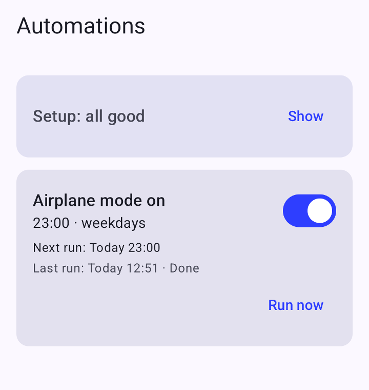
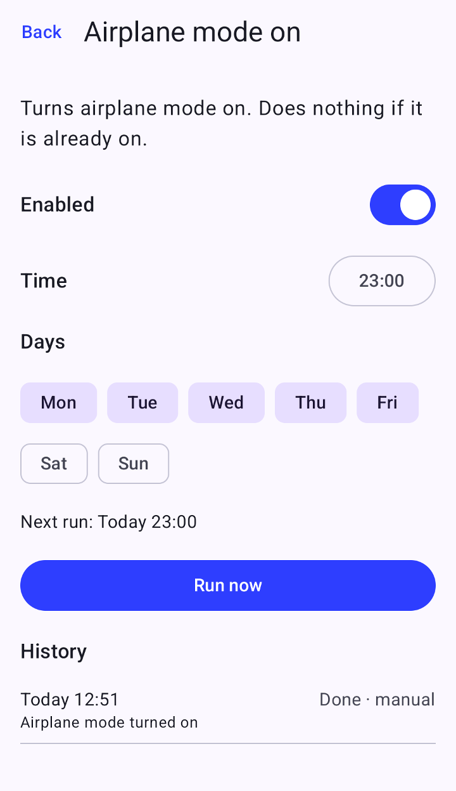

# Automations

A small Android app that runs **predefined automations** on a schedule or on demand. You see a list,
switch each automation on or off, and pick the time it runs. It needs no root, no accessibility service
and no network access.

The first (and currently only) automation turns **airplane mode on** at a time you choose, every day or on
selected weekdays. If the phone is already in airplane mode, it does nothing.

More automations are meant to be added one by one: see [Adding an automation](#adding-an-automation).

- **Version:** 1.0.1
- **Minimum Android version: Android 13 (API 33)**
- **Tested on:** Android 15 only, one device (realme RMX3890, realme UI / ColorOS 15). Other versions and
  manufacturers are untested. See [docs/TESTING.md](docs/TESTING.md).
- **License:** [MIT](LICENSE)

## Screenshots

<table>
  <tr>
    <td valign="top"></td>
    <td valign="top"></td>
  </tr>
  <tr>
    <td align="center"><sub>The list: setup status, schedule, next and last run</sub></td>
    <td align="center"><sub>The detail screen: time, weekdays, Run now and history</sub></td>
  </tr>
</table>

## How it works

- **Scheduling** uses exact alarm-clock alarms (`AlarmManager.setAlarmClock`). They fire on time in Doze and
  Battery Saver, so there is no background service and almost no battery cost. The price is an alarm icon in the
  status bar while a schedule is armed. Alarms are re-created after a reboot, an app update, and a clock or
  time-zone change, including before the first unlock.
- **Missed runs are skipped.** If the phone is off at the scheduled time, the automation does not run late:
  the next occurrence is scheduled instead.
- **Airplane mode** cannot be switched by normal apps on Android 15, and writing the setting does not turn the radios
  off. The app therefore registers as the phone's **default digital assistant**. Android lets the assistant request
  the system's "voice-control airplane mode" action, which does turn the radios off. This is the same mechanism
  other automation apps use.
- **History:** every run is logged in the app (done, skipped or failed). A notification appears only when a run fails.

### What the assistant role means for you

Only one app can be the default digital assistant. Setting this app as the assistant **replaces** the current one
(for example Google Assistant or Gemini), so the power-button or corner-swipe assistant gesture stops launching it.
The app never listens to the microphone, never reads the screen and has no assistant UI: its assistant session is
invisible and only triggers the system airplane-mode action.

## Permissions

| Permission | Why |
|---|---|
| `USE_EXACT_ALARM` | Exact alarm-clock alarms for scheduled runs (granted automatically). |
| `RECEIVE_BOOT_COMPLETED` | Re-create alarms after a reboot. |
| `POST_NOTIFICATIONS` | Tell you when an automation fails. |
| `REQUEST_IGNORE_BATTERY_OPTIMIZATIONS` | Ask for unrestricted background use so the phone's battery manager does not delay runs. |
| default digital assistant role | Required for the airplane-mode action (see above). |

There is **no `INTERNET` permission**: the app cannot send data anywhere. Schedules and run history stay in the app's
private storage and are excluded from backup and device transfer.

## Install

There are no store listings. Either download the signed APK from the
[Releases](../../releases) page, or build it yourself (see below). Then install it, with USB debugging enabled on the
phone:

```bash
adb install -r automations-1.0.1.apk
```

(You can also open the APK on the phone and allow installs from your browser or file manager.)

### Verify a download

Each release publishes `automations-<version>.apk` and a `.sha256` file. Check the file you downloaded:

```bash
sha256sum -c automations-1.0.1.apk.sha256
```

On Windows PowerShell: `(Get-FileHash automations-1.0.1.apk -Algorithm SHA256).Hash` and compare it with the `.sha256` file.
Release APKs are signed with a key whose certificate has this SHA-256 fingerprint
(check with `apksigner verify --print-certs automations-1.0.1.apk`):

```
a8eb55858f61723f49a0579dbc84102a7290b69782afe2e8816f645849da402c
```

An APK that does not match was not published by this project. Because debug and release builds are signed with
different keys, installing a release over a debug build (or the other way round) requires uninstalling the first one.

### First-run setup

Open the app. The **Setup** card at the top lists what is missing, with an **Open** button for each item:

1. **Default digital assistant**: choose *Automations* under Settings > Apps > Default apps > Digital assistant app.
2. **Notifications**: allow, so failures are not silent.
3. **Unrestricted battery use**: allow.
4. On realme / OPPO / OnePlus phones, three more items that cannot be detected automatically: **Allow auto launch**,
   **Allow background activity** (both in the app's battery settings) and **Lock in Recents**. Tap **Done** once
   you have done each.

Then turn on the switch of an automation and set its time and days in its detail screen. **Run now** triggers it
immediately and is disabled while a requirement is missing.

## Build from source

Requirements: **JDK 17 or newer**, the **Android SDK** with platform 36 (set `ANDROID_HOME`), and an internet
connection for the first Gradle sync.

```bash
./gradlew testDebugUnitTest      # unit tests
./gradlew lintRelease            # Android lint
./gradlew assembleDebug          # app/build/outputs/apk/debug/app-debug.apk
./gradlew assembleRelease        # release APK (unsigned unless you provide a signing key, see below)
```

To sign your own release build, create a keystore and a properties file **outside the repository** with the keys
`storeFile`, `storePassword`, `keyAlias` and `keyPassword`, then point `AUTOMATIONS_KEYSTORE_PROPERTIES` at it before
running `assembleRelease` (or put a git-ignored `keystore.properties` in the project root). Without it the build still
works and produces `app-release-unsigned.apk`. See [docs/RELEASING.md](docs/RELEASING.md).

On Windows with Android Studio installed, `scripts/build.ps1`, `scripts/install.ps1` and `scripts/logs.ps1` wrap the
same commands and set `JAVA_HOME`, `ANDROID_HOME` and `adb` for you.

The stack is Kotlin, Jetpack Compose (Material 3), Room, and plain `AlarmManager`. Targets API 35, compiles against
API 36.

## Adding an automation

1. Create a class implementing `Automation` under `app/src/main/java/io/github/romanfabio/automations/automation/`
   (id, title, description, optional default schedule, requirements, and a `run` function that returns
   `Success`, `Skipped` or `Failed`).
2. Add it to `AutomationRegistry`.

Storage, scheduling, boot recovery, the list/detail screens, history and failure notifications come for free.
A stable `id` is its storage key, so never rename it after release.

## Project layout

```
app/src/main/java/io/github/romanfabio/automations/
  automation/   Automation interface, registry, runner, manager, the airplane-mode automation
  assistant/    Invisible digital-assistant session used to trigger airplane mode
  schedule/     Alarm scheduling, boot/clock receivers, next-run calculation, device-protected mirror
  data/         Room database (configuration and run history)
  setup/        First-run checklist logic
  notify/       Failure notifications
  ui/           Compose screens
app/src/debug/  Debug-only adb hook (not part of release builds)
docs/           Design notes and the on-device test log
licenses/       Full license text bundled into the app (shown on the About screen)
```

More detail: [docs/DESIGN.md](docs/DESIGN.md).

## Known limitations

- Android 15 on one realme phone is the only tested combination.
- Deep Doze, a scheduled run before the first unlock after a reboot, and a live time-zone change could not be
  reproduced during testing. The code covers them, but they are unverified on a device ([docs/TESTING.md](docs/TESTING.md)).
- Wi-Fi and Bluetooth follow Android's own rules for airplane mode (they stay on if you turned them back on while in
  airplane mode).
- Not suitable for the Google Play Store as is: the battery-optimization and exact-alarm requests fall under Play
  policy restrictions.
- Phone makers that aggressively kill background apps may need the extra settings above.

## Contributing

Issues and pull requests are welcome. Please run `./gradlew testDebugUnitTest lintRelease` first and keep
[CLAUDE.md](CLAUDE.md) (the project's working conventions) in mind.

## License

Released under the [MIT License](LICENSE). Third-party libraries and their licenses are listed in
[THIRD_PARTY_LICENSES.md](THIRD_PARTY_LICENSES.md) and are also shown inside the app, under **About** (top right of the
main screen), together with the full Apache License 2.0 text ([licenses/APACHE-2.0.txt](licenses/APACHE-2.0.txt)).
